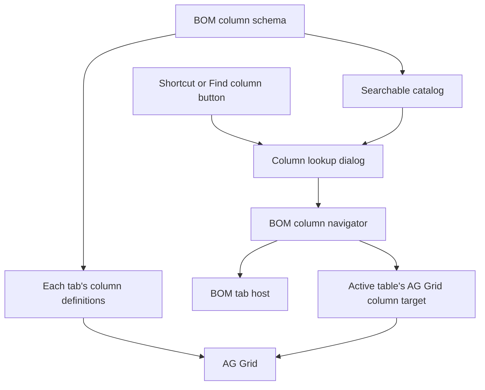

# BOM column lookup design

Status: proposed architecture, ready for implementation once the BOM tab host is available.

## Scope and repository fit

Provide one Ctrl+K / Cmd+K column lookup for all three BOM tabs. A result identifies a column in a specific tab. Selecting it activates that tab, reveals the column, scrolls horizontally, and focuses its header. Row selection, row filters, sorting, and cell values remain unchanged.

This checkout uses Angular 21, Material 21, and AG Grid 36.2. It contains a grid demo rather than the three BOM tabs. `features/grid-demo/demo-columns.ts` builds columns with renderer and persistence dependencies; `grid-demo.ts` owns the grid lifecycle. Do not import that column factory just to populate search, because doing so couples search to table initialization. The design below uses a lightweight schema shared by column construction and search.

Keep the initial implementation under `features/bom/column-lookup`. Do not add lookup behavior to `shared/grid-cells`, editor persistence, or `EditorHostService`. This feature navigates columns and owns a separate Material dialog. Extract reusable code only when another feature needs it.

## Ownership

| Module | Owns | Must not own |
| --- | --- | --- |
| BOM column schema | Stable column IDs, labels, group paths, aliases, tab membership, view eligibility | Live grid instances, renderer factories, row data |
| Column lookup | Dialog lifetime, query, result ranking, selection and user feedback | AG Grid calls, tab rendering details |
| BOM column navigator | Tab activation, pending navigation, live table registration, cancellation | Search matching or dialog markup |
| AG Grid column target | Grid readiness, visibility, group expansion, scrolling and header focus | Tab switching or result ranking |

Column navigation is the deep module: callers request one destination and receive a result. Lifecycle ordering, destroyed grids, and delayed rendering stay inside its implementation. The seam between the navigator and each table lets the three tabs share navigation behavior while keeping their row types private.



## Data contracts

The following types describe the intended interface, not existing implementation. Replace the example tab IDs with the actual BOM tabs.

```ts
type BomTabId = 'materials' | 'operations' | 'summary';

interface ColumnAddress {
  readonly tabId: BomTabId;
  readonly columnId: string;
}

interface SearchableColumn {
  readonly address: ColumnAddress;
  readonly label: string;
  readonly tabLabel: string;
  readonly groupPath: readonly string[];
  readonly aliases: readonly string[];
}

type NavigationResult =
  | { readonly kind: 'focused'; readonly address: ColumnAddress }
  | { readonly kind: 'cancelled' }
  | {
      readonly kind: 'unavailable';
      readonly reason:
        | 'missing-column'
        | 'access-denied'
        | 'activation-failed'
        | 'not-ready'
        | 'editing-active';
    };
```

Use the pair of tab ID and column ID as identity, never the displayed label or column index. Give every searchable AG Grid column an explicit matching `colId`. Reordering, localization, and duplicate labels must not change identity.

The schema is the source of column labels and IDs. Each table adds its own getters, renderers, editors, and persistence behavior when constructing `ColDef<T>`. Search reads the schema without instantiating any table. If dynamic columns come from the server, load their metadata independently of rows and update the catalog when that metadata changes.

Filter the catalog using current view eligibility. Edit permission does not determine whether a column is searchable. User-hidden columns remain searchable; unauthorized columns do not. Recheck eligibility at selection time. Local filtering does not replace server authorization.

## Search and dialog

Expose `open(trigger: HTMLElement): void` from the lookup module. Repeated calls while open focus the existing input rather than creating another dialog.

Use an OnPush standalone dialog with Material autocomplete and a non-nullable reactive `FormControl<string>`. Convert value changes to a signal, and derive results with Angular `computed()`. Use `input()` / `output()` for component bindings where needed. No global store or backend search is needed for this column catalog.

Normalize query and metadata by trimming, collapsing whitespace, and case folding. Require all query tokens to occur across the label, aliases, group path, or tab label. Rank exact label matches first, followed by label prefixes, label word matches, alias matches, and contextual matches. Use the active tab as a tie-breaker, then schema order for deterministic results. Precompute normalized metadata when the catalog changes, not on every keystroke.

Show at most 20 results. An empty query shows columns from the current tab first. Every option includes its column label and tab/group context, even when labels are unique. For example, `Unit cost — Materials / Pricing`. Include a note that user-hidden columns will be revealed on selection; mark individual hidden results only when authoritative visibility state is available. Do not mount inactive grids to inspect their visibility.

Use a labeled input and dialog title, accessible autocomplete options, arrow-key navigation, Enter to select, and Escape to dismiss. Keep focus in the dialog while open and announce result counts without excessive repetition. Provide a visible Find column button with `aria-keyshortcuts="Control+k Meta+k"`.

Bind the document shortcut once on the BOM shell using Angular's `host` metadata. Only handle it while that shell is active; ignore repeated/composing events and unrelated modifiers. Call `preventDefault()` only when handling the shortcut. If a cell editor or another modal owns interaction, leave that interaction intact and announce that editing must finish first. Do not silently save or discard edits to navigate.

## Navigation interface and lifetime

Provide lookup and navigation state at the BOM shell, shared by its three child tabs. These are page instances, not root singletons. Destroying the shell closes its dialog, cancels pending work, and releases grid references. Services that truly are application singletons use `providedIn: 'root'`.

The caller-facing navigation operation is:

```ts
goTo(address: ColumnAddress): Promise<NavigationResult>;
```

Table integration is internal to the feature:

```ts
interface ColumnTarget {
  revealAndFocus(
    columnId: string,
    signal: AbortSignal,
  ): Promise<NavigationResult>;
}

registerTarget(tabId: BomTabId, target: ColumnTarget): () => void;
```

The registration disposer removes only the registration it created. An old table's destruction must not unregister a newer instance of the same tab. Register on grid creation, remove on destruction, and keep AG Grid's generic row type inside the concrete target implementation. Readiness belongs inside the target rather than being a prerequisite callers must manage.

The navigator uses the BOM shell's existing tab selection mechanism directly. Implement that integration for the actual host, whether Material tabs or routed tabs; do not build a generic tab-driver framework in advance.

## Selection sequence

1. Snapshot the selected address and recheck that it is still in the permitted catalog.
2. Close the dialog and wait for its close completion before transferring focus. Disable Material's automatic focus restoration for this selection path.
3. Start one navigation request with an AbortController and request identity. A newer request cancels the previous one. Shell destruction or unrelated manual tab navigation also cancels it.
4. Activate the destination tab. Handle route rejection, lazy-load failure, and tab activation failure as explicit unavailable results.
5. Wait for its registered target and visible tab layout. For a new grid, wait for initial rendering as well. A mounted inactive grid may already be rendered but still have zero width.
6. Recheck the request identity, current tab, view eligibility, and column existence. Reveal a user-hidden column and expand the ancestor groups needed to display it. Respect app restrictions on column visibility.
7. After the resulting layout is ready, call `ensureColumnVisible(columnId, 'middle')`, then `setFocusedHeader(columnId)`. Check that the request is still current before every mutation or focus transfer. Pinned columns need focus but no horizontal scroll.
8. Announce the column and tab reached. Resolve the request and remove subscriptions, readiness observers, and cancellation handlers.

Use lifecycle events and measured visible layout rather than arbitrary sleeps. Bound readiness waits with a named timeout, initially 10 seconds, so failed initialization cannot wait forever. Return `not-ready` with a retry message on timeout. The timeout is a failure bound, not a delay before scrolling.

AG Grid documents that `ensureColumnVisible` has no effect before `firstDataRendered`. The target must also support an empty table: verify the installed grid's empty-data rendering events and header readiness rather than requiring a row to exist. If the column cannot be focused, return failure instead of reporting success. Register the required grid API modules; the current demo registers `AllEnterpriseModule`, but a production table may register a smaller set.

Cancellation prevents future side effects; it does not roll back tab activation or column visibility changes already completed. Do not steal focus back after a cancellation caused by newer user interaction. On ordinary dialog dismissal restore the original trigger if connected, otherwise the shell's Find column button. On navigation failure announce the reason and focus that button. Successful navigation leaves focus on the destination header.

## Proposed files

```text
features/bom/
  bom-column-schema.ts
  bom-shell.ts                         # Actual tab integration and shortcut
  column-lookup/
    column-lookup.model.ts
    column-search.ts                   # Pure indexing and ranking
    column-lookup.ts                    # Dialog lifetime and selection
    column-lookup-dialog.ts
    column-lookup-dialog.html
    column-lookup-dialog.scss
    bom-column-navigator.ts            # Activation, registration, cancellation
    ag-grid-column-target.ts           # AG Grid lifecycle and focus
```

Keep the search function pure. Keep readiness and scrolling in one AG Grid implementation shared by all three tabs. Avoid a separate class for every navigation step or a global command registry for one command.

## Validation and delivery

Test through the module interfaces:

- Search ranking, aliases, multiword queries, duplicate labels, empty query, and permission-driven catalog updates.
- Navigation to an unloaded tab, an already-mounted inactive tab, and an empty table.
- Hidden columns, nested groups, reordered columns, pinned columns, and an initially virtualized offscreen header.
- Rapid replacement of requests, manual tab changes, destruction during activation, stale disposers, missing columns, and bounded readiness failures. Verify cancelled requests never later scroll or move focus.
- Keyboard-only opening, selection, dismissal, editor conflicts, and focus restoration. Run AXE on the dialog and destination page, plus manual keyboard and focus checks; AXE alone does not establish WCAG AA compliance.

Implement the schema and pure search first, then navigation and the AG Grid target, then the dialog and shortcut. Integrate all three real tabs and run the Angular build, focused unit tests, and Playwright keyboard/AXE checks. This document alone changes no runtime behavior and requires no build.

## Decisions to confirm during integration

The actual tab IDs and activation mechanism are absent from this checkout. Map them when the BOM feature is supplied. Also identify whether hidden-column state is already persisted and whether any dynamic column groups have special display restrictions. Use existing application behavior for those cases rather than creating a second state store.

Reference: [AG Grid 36.2 grid API](https://www.ag-grid.com/angular-data-grid/grid-api/) for column visibility, group expansion, scrolling, and header focus.
