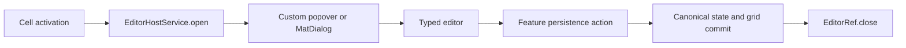

# Cell kit flows

Use this guide to trace editing through the current files. [Design](ag-grid-cell-kit-design.md) describes the types and ownership; [usage](cell-kit-usage.md) provides consumer examples.



The host manages presentation. It neither authorizes a business save nor applies rows. A renderer's data factory binds a generic field editor to the appropriate feature action. A complex editor calls its feature actions directly.

## Rendering and refresh

1. AG Grid calls [BaseCell.agInit](../src/app/shared/grid-cells/core/base-cell.ts), or refresh on an existing renderer. Both shallow-copy the params into its signal. Refresh returns true.
2. Each renderer's explicit computed signals call the pure category functions, such as [computeMarker](../src/app/shared/grid-cells/capabilities/marker.ts) and [computeNumberContent](../src/app/shared/grid-cells/capabilities/number.ts).
3. Angular updates the existing content, marker and action elements. A metadata-only refresh can change permission or marker while retaining the content span and renderer instance.

Presentation rules can read application signals inside these computed calculations. A settings change invalidates only the dependent computations and Angular updates their templates; it does not require a grid refresh or new column definitions. The [integration guide](cell-kit-integration.md) explains dependency tracking and keyboard setup.

Row commits have a separate owner. Connected feature updates refresh affected rows after transactions, mutations or dataset replacement. RowData-bound tables can use an explicit rowDataUpdated handler to refresh visible metadata when values are unchanged. There is no integration observer. In-place row mutation still needs the feature's explicit refresh, and presentation signals do not update sorting/filtering/aggregation automatically.

## Opening a popover from a pen

| File and method                                                                                                                                | What happens                                                                                                                                                              |
| ---------------------------------------------------------------------------------------------------------------------------------------------- | ------------------------------------------------------------------------------------------------------------------------------------------------------------------------- |
| [CellEditAction](../src/app/shared/grid-cells/capabilities/action.ts)                                                                          | Guards disabled activation and emits the native mouse event                                                                                                               |
| [EditCell.open](../src/app/shared/grid-cells/renderers/edit-cell.ts) and [openCellEditor](../src/app/shared/grid-cells/capabilities/action.ts) | Reads current params/action, captures the button trigger, calls action.editor.data(cell), resolves action.editor.presentation options, then calls context.editorHost.open |
| [EditorHostService.open](../src/app/shared/grid-cells/editing/editor-host/editor-host-service.ts)                                              | Rejects a busy/destroyed owner or disconnected trigger; creates a child injector containing this opening's EditorRef                                                      |
| [PopoverEditorPresentation](../src/app/shared/grid-cells/editing/editor-host/presentations.ts)                                                 | The host looks up the adapter for the presentation kind. This one delegates to the app popover, supplies editor backdrop defaults and connects presentation closure       |
| [PopoverService.open](../src/app/shared/popover/popover-service.ts)                                                                            | Creates the CDK overlay, position/arrow, focus trap, scroll strategy and content component                                                                                |
| [bindEditorData](../src/app/shared/grid-cells/editing/editor-host/bind-editor-data.ts)                                                         | Sets the signal input using Angular's declared public input name before first render and ngOnInit                                                                         |
| [InputEditor.ngOnInit](../src/app/shared/grid-cells/editing/editors/input-editor.ts)                                                           | Initializes the field and configured validators from the opening data                                                                                                     |

The default anchor is the pen trigger. A popover config factory receives CellOpenContext so it can choose another element anchor or an explicit point. Grid editor opening carries no clickPoint. The standalone app popover supports click-point fallback for other application uses.

The opening data is the editor's initial draft. Persistence looks up the current canonical row again at save time. The renderer instance does not need to survive the entire save.

## Opening a dialog

With `presentation: { kind: 'dialog' }`, [EditCell.open](../src/app/shared/grid-cells/renderers/edit-cell.ts) follows the same renderer flow and passes `{ kind: 'dialog', options }` to the host. [DialogEditorPresentation](../src/app/shared/grid-cells/editing/editor-host/presentations.ts) uses Angular Material MatDialog and its focus trap. [DialogEditorPanel](../src/app/shared/grid-cells/editing/editor-host/dialog-editor-panel/dialog-editor-panel.ts) mounts the configured editor. It has no common Save/Cancel footer.

The host binds the same HostedEditor data contract and provides the same EditorRef in both presentations. DialogOptions configures title, dimensions and backdrop dismissal. A dialog does not require a live anchor after opening and can remain open when the original cell disappears.

## Generic field save

```text
InputEditor.save or TextareaEditor.save
  -> data.save(draft)
  -> feature.saveAmount / saveName / saveNotes(EditCommand<T>)
  -> feature commits canonical state and synchronizes the grid
  -> save promise resolves
  -> editor's EditorRef.close
```

[InputEditor.save](../src/app/shared/grid-cells/editing/editors/input-editor.ts) marks the control touched, rejects invalid/pending validation or duplicate saves, captures its value, and awaits the configured callback. [TextareaEditor.save](../src/app/shared/grid-cells/editing/editors/textarea-editor.ts) uses the same contract for a string draft.

The callback is created by the column's editor data factory. [Demo columns](../src/app/features/grid-demo/demo-columns.ts) bind cell identity and column query params directly to a named feature action. No host service participates in payload construction or persistence.

On success, the editor closes. On failure, it displays the error and retains the draft for retry. Cancel, Escape or a dismissible backdrop discards an unsubmitted draft. If dismissed after submission, the feature action can still complete. The opening-specific EditorRef cannot close a later editor.

## Complex save and approval

[DetailsEditor.submit](../src/app/features/grid-demo/editors/details-editor.ts) checks its own Reactive Form and pending guard. It builds a command containing name, amount, notes, opening revision, cell identity and query params. It calls saveDetails or approveDetails on the selected feature persistence implementation.

Server saveDetails uses PATCH to the details endpoint; approveDetails uses POST to the approval endpoint with the current draft. The host does not select these actions. The complex editor closes after success and retains its form after failure.

The demo's mode selection chooses the two real persistence implementations directly. A table configured with only one implementation can inject the feature token without any mode selection.

## Server action and returned dataset

The methods below are inside [DemoServerPersistence](../src/app/features/grid-demo/demo-server-persistence.ts).

1. A public feature method, such as saveAmount, calls its private enqueue method. The method snapshots the typed command and current dataset generation, increments pending count and appends to the feature FIFO queue.
2. Execute checks owner lifetime and generation, reads the current row from DemoTableState, and authorizes the action through [demo-edit-intent.ts](../src/app/features/grid-demo/demo-edit-intent.ts).
3. The private payload calculation validates business data and complex-editor revision. It preserves unrelated current row fields. Execute chooses the method/endpoint and serializes query params through [demo-http-params.ts](../src/app/features/grid-demo/api/demo-http-params.ts). Array values become repeated query keys.
4. After HTTP returns, execute checks lifetime/generation again. [readDemoResponse](../src/app/features/grid-demo/api/demo-api.model.ts) validates the row set and unique nonempty IDs.
5. [DemoTableState.commitServerUpdate](../src/app/features/grid-demo/demo-table-state.ts) replaces or upserts canonical rows. Its private publishRows first calls DemoGridUpdates.replace, then publishes the rows signal.
6. [DemoGridUpdates.replace](../src/app/features/grid-demo/demo-grid-updates.ts) expires the cache, sets rowData on the connected grid and force-refreshes returned row nodes so unchanged displayed values still receive new metadata.
7. The feature publishes completion and fulfills the action promise. The editor closes if still open.

Replace-rows removes omitted rows and accepts an empty dataset. Upsert-rows retains omitted rows and appends new IDs. The edited row may disappear in a valid response. A valid response does not increase dataset generation.

All dataset-replacing actions share the queue, including actions from different rows or editors. A later queued action reads the rows committed by its predecessor. A rejected action does not block the next action. Closing an editor does not empty this queue.

The demo commits through a connected grid. The small server-only [AmountTableExample](../type-tests/docs/amount-table-example/amount-table-example.ts) instead publishes a rows signal bound to rowData. These are separate synchronization choices.

## Client transaction

[DemoClientPersistence](../src/app/features/grid-demo/demo-client-persistence.ts) implements the same feature actions. Its private save method reads the current row, authorizes and validates the draft, and calculates normalized affected rows including the dependent row. It sends no HTTP request.

[DemoTableState.commitClientRows](../src/app/features/grid-demo/demo-table-state.ts) checks identities/order and selects changed rows. DemoGridUpdates.commit then:

1. Checks that every affected grid node references the current canonical row.
2. Expires the value cache and calls applyTransaction once with complete affected replacement rows.
3. Verifies the transaction result and new node references.
4. Recalculates the client-side model if automatic transaction recalculation was suppressed.
5. Force-refreshes all columns in affected rows, because metadata can change any marker or permission.
6. Returns the canonical row array with updated references and stable unaffected references.

Table state publishes that array once. Feature completion is published before the promise fulfills. The normal transaction strategy is the default in provideDemoClientEditing().

## Client mutation

With provideDemoClientEditing('mutation'), the authorization and local calculation are identical. DemoGridUpdates.commit assigns calculated fields into the existing feature-owned row objects rather than issuing a transaction. It replaces changed nested metrics/metadata objects, runs the client-side model from the grouping stage and force-refreshes affected rows.

The canonical array is new, while row references remain stable. Reset and server inputs are copied into feature ownership. Never choose this strategy for NgRx entities or other immutable external rows.

If a client commit fails, the private grid implementation restores mutated snapshots or the previous rowData before rejecting. New canonical state is not published. Missing, disconnected or out-of-sync grid nodes reject before mutation. [Client persistence tests](../src/app/features/grid-demo/demo-client-persistence.spec.ts) exercise both strategies against real grid instances.

## Toggle and dropdown

The [cellToggle](../src/app/shared/grid-cells/capabilities/toggle.ts) directive guards permission and pending state and emits the next value. [ToggleCell.change](../src/app/shared/grid-cells/renderers/toggle-cell.ts) runs toggle.save(nextBoolean, currentCellContext) through `trackSave`, which keeps the pending and failed state in the grid context's `CellOperations` when one is provided, and announces a failure. The feature binds the context to EditCommand and commits. The displayed value remains committed until refresh. There is no popup or pen for this control.

[DropdownCell.open](../src/app/shared/grid-cells/renderers/dropdown-cell.ts) captures current options and value, constructs typed DropdownEditorData, and opens the shared host's popover. [DropdownOptionsEditor.choose](../src/app/shared/grid-cells/renderers/dropdown-options-editor.ts) checks the option, closes without saving for an unchanged selection, awaits its save callback and closes on success. Failed saves preserve the open options and committed selection. Its error is displayed. The dropdown has no Cancel button or radio decoration.

[ToggleNumberCell](../src/app/features/grid-demo/cells/toggle-number/toggle-number-cell.ts) composes a native switch and number content with a pen. Its switch can permit a review change while its number permission denies editing. The feature routes an amount command from toggle-number to metric 7, independently from the ordinary metric-2 action.

## Dismissal, focus and reset

EditorHostService.dismiss is idempotent. It clears active state, disposes subscriptions/child injector and closes the presentation. It restores focus after the next render to the connected trigger, previous focus target or a focusable owner control. Feature destruction disposes without restoring focus into a removed owner.

The app popover observes trigger/element-anchor removal and closes when either disconnects. Escape closes the latest registered overlay. A backdrop closes by default unless closeOnBackdropClick is false. Popovers block background scrolling unless scrollable is true; their content remains scrollable. Dialogs block background scrolling and use Material's focus trap.

DemoTableState.reset validates the new dataset, increments its generation, closes the owner's active editor and replaces rows. Pending server responses and queued commands from the old generation cannot commit. Destruction settles pending/queued callers and blocks late commits. The host never looks up rows or reconciles the dataset itself.

Feature pending/completion signals retain feedback independently of presentation. A failure remains visible after its editor closes. See [feature persistence](feature-persistence.md) for provider setup and [historical measurements](measurements.md) for dated verification evidence.
