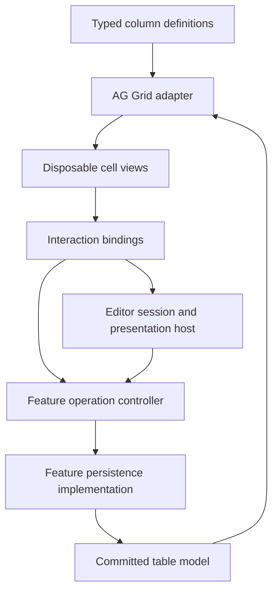

# New table system implementation plan

Status: proposed implementation plan. This document does not authorize a migration or modify application behavior.

## Objective

Build a new table editing system alongside the existing implementation. Preserve the required behavior, while designing ownership, contracts, and composition independently of the current grid-cell architecture.

The system must support formatted text and numbers, units, annotations, permissions, direct toggles, choices, draft editors, multi-field operations, asynchronous persistence, dependent row updates, and virtualization. Cells are disposable views. Committed data, operation status, and submitted work belong to the feature.

## Isolation requirements

- Create new code under `src/app/shared/table-system/` and `src/app/features/table-system-lab/`.
- Create an isolated Angular demo workspace under `labs/table-system/`, with its own bootstrap, Angular configuration, TypeScript configuration, and Playwright configuration. Use the repository's installed dependencies. Document commands in the new workspace README.
- Do not change existing routes, application providers, package scripts, cell renderers, editors, persistence services, tests, or documentation. The existing demos remain available unchanged.
- Do not import from `shared/grid-cells`, `shared/grid-cells/editing/editor-host`, or `features/grid-demo`. Create independent demo data and domain operations.
- Reuse the existing `shared/popover` implementation only through a new presentation adapter. Do not change its implementation, public contracts, or styles.
- Use Angular, Angular Material/CDK, and AG Grid directly where appropriate. New styles must use a `tsys-` prefix and apply only within the new application or components.
- Keep all new feature state feature-scoped. No global operation registry, editor state, or monkey-patched grid behavior.
- Migration, replacement of the old system, and main-application route registration are separate future work.

## Architecture and ownership



| Module                    | Owns                                                                                                                | Must not own                                          |
| ------------------------- | ------------------------------------------------------------------------------------------------------------------- | ----------------------------------------------------- |
| Table model               | Immutable committed rows, dataset identity and generation, atomic change publication                                | DOM, HTTP endpoints, editor drafts                    |
| Operation controller      | Submission admission, conflict scopes, pending/error status, completion, stale-result guards                        | Grid handles, formatting, domain payload construction |
| Feature operations        | Domain commands, current-state validation, authorization rules, local or remote persistence, response normalization | Renderer lifetime or overlay mounting                 |
| AG Grid adapter           | Grid lifecycle, row synchronization, cell snapshots, column integration, keyboard and logical focus                 | Authoritative row mutation or request ordering        |
| Presentation calculations | Display text, annotations, alignment, emphasis, accessible descriptions                                             | Persistence, overlays, writable state                 |
| Interaction bindings      | Read interaction state, guard activation, submit or launch an editor                                                | Copies of durable pending state                       |
| Editor session            | Draft lifetime, captured base revision, submission association, close semantics                                     | Authoritative row updates                             |
| Editor content            | Reactive forms, validation, operation-specific actions                                                              | Popover/dialog APIs or AG Grid APIs                   |
| Presentation host         | Mounting, dismissal, disposal, focus return                                                                         | Validation or persistence                             |

The table model accepts normalized updates from feature operations. The operation promise resolves after the table model commits the accepted result. The AG Grid view follows that model; its rendering is not part of the business transaction.

## Contracts to settle before implementation

### Cell addresses and edit targets

- A cell address identifies a row and column for presentation and navigation.
- An edit target identifies a business entity and an operation, independently of column placement.
- A dataset identity and generation distinguish work for different datasets and resets.
- A conflict scope describes which operations may not execute together. It may cover one entity or the entire table.
- Two controls editing the same review flag must observe the same operation status, even when they occupy different columns.
- Distinguish data cells from group, aggregate, and loading cells. Only valid data cells receive editing bindings by default.

Use typed operation definitions to retain the relationship between command input and accepted result. Do not introduce an untyped string-event bus. Transport commands contain plain data and stable identities, never grid nodes, component references, or live row objects.

### Committed table model

Expose read-only row state, lookup by stable identity, dataset replacement, and atomic application of normalized updates. Validate updates before changing state. A patch batch either commits completely or fails without changing rows.

Start with immutable rows and explicit patch-versus-replacement update results. A reset changes the dataset generation; a successful save does not. Store independent model tests without Angular components or AG Grid test doubles.

### Operation execution

Provide a small interface to bind a typed operation to a target, read its status, and submit a command. Define idle, pending, and failed states as a discriminated union. Report successful completion separately and return to idle after commit.

Default policy:

1. Validate the command and check permissions against current feature state.
2. Acquire its conflict scope synchronously before starting asynchronous work.
3. Reject duplicate submissions and conflicting submissions with a typed busy outcome. Do not queue clicks against an old displayed value.
4. Allow operations on independent scopes concurrently.
5. Execute persistence and normalize the accepted result.
6. Check dataset generation, operation identity, and applicable revision constraints before commit.
7. Commit the normalized update atomically and publish completion.
8. Release the pending scope on success or failure. Keep actionable failure feedback until retry or explicit dismissal.

The feature defines the scope. Operations with table-wide effects use a table-wide scope. Revision-based server conflicts preserve the draft and report a conflict; the runtime must not silently rebase or retry it.

Feature destruction invalidates local results and aborts transport where supported. Aborting a request does not prove that a remote write was rolled back. Dataset replacement closes drafts and prevents old responses from changing the new dataset.

Use pessimistic display in the first release. Optimistic updates, automatic retries, offline queues, and undo are outside the initial scope.

### Display and interaction composition

Column definitions describe value access, display, annotations, and interactions independently. The typed column builder verifies the relationship among row value, editor output, and operation input before producing normal AG Grid column definitions.

Keep supported layouts small: value, switch, choice, and custom composition. Text and number formatting are display strategies. Popover and dialog are editor presentation choices, not renderer categories.

Each interaction has its own permission, accessible label, target binding, and pending/error state. Visual muting does not imply disabled interaction. Share a permission rule explicitly when two controls need the same policy.

Use deterministic annotation priority. Keep essential errors and warnings available in accessible descriptions even when only one visual indicator fits. Define null, empty string, zero, non-finite numbers, unmatched choices, and unit formatting behavior explicitly.

### Reactivity

Use signals for observable state and explicit `computed()` calls in renderers. Name pure calculations `compute*` and renderer category signals `cellContent`, `cellMarker`, `cellAction`, and corresponding category names.

Row commits travel through the model and grid adapter. Presentation settings can update computed display state without replacing rows or rebuilding columns. Pure calculations receive normalized cell facts and configuration, not AG Grid runtime objects.

Expose operation status at a target or scope level so an unrelated operation does not force every visible cell to recompute. Release view subscriptions when renderers are destroyed. Define bounded cleanup for completed targets; avoid retaining every cell ever visited.

### Editor sessions and presentations

An editor receives typed initial data and session actions through signal inputs or scoped injection. It owns a Reactive Form and emits typed submissions. Capture initial values and revisions when creating the session; never depend on a mutable live row as the draft baseline.

Simple editors cover text, nullable numbers, multiline text, and choices. Complex editors can submit distinct domain actions such as Save and Approve through the same operation controller. They are not forced into a single-field contract.

Start with one active editor session per feature. Opening another editor returns an explicit already-open outcome. Avoid silent draft replacement.

| Event                                                   | Required behavior                                                                 |
| ------------------------------------------------------- | --------------------------------------------------------------------------------- |
| Escape, backdrop dismissal, or Cancel before submission | Close session and discard draft                                                   |
| Dismissal after submission                              | Close session; submitted work continues and reports feature feedback              |
| Validation failure                                      | Keep draft; identify invalid fields and focus the first invalid field             |
| Save failure while open                                 | Keep draft; show associated error and allow deliberate retry                      |
| Save success while open                                 | Close the matching session after commit                                           |
| Completion from an older closed session                 | Never close or mutate a newer session                                             |
| Dataset reset or feature destruction                    | Close active editor and invalidate obsolete local completions                     |
| Popover anchor removed by virtualization                | Close that session and discard any unsubmitted draft; keep submitted work running |

### Reusing the current popover

Implement one adapter around the existing `PopoverService.open`, `PopoverRef.close`, and `afterClosed`. Supply the feature injector and feature `DestroyRef` through the existing request. Initialize typed editor content through the existing initialization callback.

The popover already closes when its anchor is removed and already performs focus trapping and connected-trigger focus restoration. Preserve those behaviors. The new host adds logical-cell fallback only when the trigger cannot receive focus; it must not compete with successful native restoration or steal focus from a newer overlay.

Test the timing of disposal and `afterClosed`, including editors that close during initialization. If a desired behavior cannot be implemented using the existing contract, record the limitation and adapt the new system's policy. Do not modify the shared popover to accommodate it.

Implement dialog presentation separately using Material/CDK. Editor content remains presentation-independent.

## New file organization

```text
src/app/shared/table-system/
  model/               # Identities, committed state, normalized updates
  operations/          # Submission policy and observable operation state
  presentation/        # Pure display and annotation calculations
  interactions/        # Bindings for direct operations and editor launch
  editors/             # Session contract and reusable field editors
  hosts/               # New host, existing-popover adapter, dialog adapter
  ag-grid/             # Lifecycle, columns, row synchronization, focus
  renderers/           # Small built-in Angular views and composition helpers
  styles/              # Scoped tsys styles
  public-api.ts        # Ordinary feature integration
  composition-api.ts   # Custom renderer/editor authoring

src/app/features/table-system-lab/
  domain/              # Independent rows, permissions, operations and fixtures
  persistence/         # Local and deterministic simulated-server behavior
  cells/               # Composite renderer demonstrating extension
  editors/             # Multi-field editor with Save and Approve
  table-system-lab.ts

labs/table-system/
  ...                  # Independent Angular and browser-test host
```

Keep implementation details private by default. Add exports when the lab demonstrates a concrete caller need. Do not create an abstraction for switching grid vendors.

## Delivery phases

Implement each phase as an additive, reviewable change. A phase is complete only when its acceptance checks pass.

### Phase 1: isolated host and first display

Create the new workspace, independent fixtures, stable row identities, minimum model contract, AG Grid adapter, and one formatted-number column. Keep application routes and configuration untouched.

Acceptance: the isolated app starts and builds using installed dependencies; zero, missing values, decimals, and units render correctly; changing a presentation signal updates the existing view. Record repeatable development and test commands.

### Phase 2: committed model and asynchronous toggle

Implement atomic updates, feature operation state, target/conflict scope identity, and the direct switch binding. Add a deterministic delayed persistence implementation capable of success, failure, and normalized results.

Acceptance: repeated activation submits once; independent scopes proceed concurrently; scrolling away and back preserves pending state; two controls for one target share status; failure preserves committed data; a stale response after reset cannot commit. This phase is the first architecture checkpoint.

### Phase 3: one editor through the existing popover

Implement editor sessions, the presentation host, the popover adapter, and a numeric Reactive Form editor. Define focus-return behavior and distinguish draft dismissal from submitted work.

Acceptance: invalid drafts do not submit; failed saves preserve the draft; dismissal does not cancel submitted work; removed anchors close drafts; older completions cannot affect newer sessions; feature destruction leaves no overlay resources.

### Phase 4: complete the display and interaction vocabulary

Add text formatting, annotation priority, accessible descriptions, switch/choice layouts, typed column helpers, and keyboard integration. Add permission and presentation-signal behavior without rebuilding column definitions.

Acceptance: types reject mismatched values, editors, and commands; every interaction owns its permission; choice equality and disabled options work; keyboard entry, internal traversal, reverse traversal, and exit work for all built-in layouts.

### Phase 5: complex editors and composition checkpoint

Add dialog presentation, text and multiline editors, a multi-field editor with Save and Approve, and a custom toggle-number renderer. Demonstrate one editor in both popover and dialog presentations.

Acceptance: the composite renderer supplies layout and calculations without copying save lifecycle or overlay code; number display is identical with and without an editor; a multi-field save atomically updates dependent cells and rows; permissions revalidate at submission.

### Phase 6: grid synchronization and production behavior

Exercise sorting, filtering, grouping, row replacement, row removal, and metadata-only changes. Ensure the model stays authoritative if the grid disconnects or rendering fails; reconstruct the grid projection on reconnect rather than rolling back an accepted business commit.

Acceptance: updates recalculate affected grid behavior; unavailable/group/loading cells cannot submit edits; a disconnected view can reconnect to current committed data; reset advances the generation and invalidates old drafts and completions.

### Phase 7: verification and handoff

Finish architecture documentation, usage examples, extension guidance, and the isolated showcase. Record performance measurements with the fixture size, visible-cell count, environment, and repeatable interaction sequence. Check initial rendering, sustained scrolling, signal-only changes, and repeated editor open/close cycles. Investigate regressions against the new system's Phase 1 baseline; do not invent performance claims.

Acceptance: all new unit, type, browser, and accessibility checks pass; new app production build passes; no prohibited imports or existing-system edits appear in the final diff. Implementation ends with the new system running independently. Migration remains unstarted.

## Verification strategy

- Test model and operation contracts with deterministic fake persistence and deferred promises. Cover atomicity, conflict scopes, stale generations, revisions, failures, and destruction.
- Use compile-time tests for renderer/configuration relationships and editor/command compatibility, including expected rejections.
- Test presentation calculations independently and Angular views through their rendered behavior. Cover signal changes and renderer recreation.
- Use browser tests for actual AG Grid virtualization, keyboard traversal, overlay focus, anchor removal, and dismissal during pending requests. Unit tests alone cannot establish these behaviors.
- Run AXE on the table and each open editor state. Also check keyboard-only flows, focus visibility, accessible names/descriptions, announcements, and WCAG AA contrast manually; passing AXE alone is insufficient.
- Verify the existing popover through the new adapter tests without rewriting its tests. Run the relevant existing regression checks before handoff using their existing commands.
- Record the pre-existing working-tree changes before implementation. Audit changes against that recorded starting state so existing user work is preserved and not mistaken for new-system edits.

## Definition of done

The new isolated demo demonstrates read-only text and numbers, annotations, independent permissions, asynchronous toggles, choices, popover and dialog editors, multi-field operations, and a custom composite cell. All use one authoritative table model and feature-owned operation status. Scrolling cannot lose pending state or permit duplicate submissions. Failed and stale saves cannot corrupt committed data. Custom layouts reuse interaction behavior without copying its lifecycle implementation.

The current system and shared popover implementation remain unchanged.
