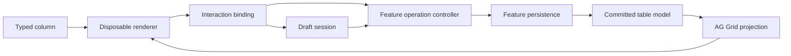

# Table system architecture and integration

The feature owns one `TableModel`, `OperationController` and `EditorSessions` instance. Renderers are disposable views. The standalone lab constructs these instances on its component and destroys the controller and sessions with its feature `DestroyRef`.

| Owner                          | Contract                                                                                                                             |
| ------------------------------ | ------------------------------------------------------------------------------------------------------------------------------------ |
| TableModel                     | Read-only immutable row snapshots, indexed stable-identity lookup, dataset generation and validated atomic patch/replacement commits |
| OperationController            | Synchronous target/scope admission, per-target signals, aborts, failure feedback, completion publication and stale result guards     |
| Feature operations             | Current-state permission and revision checks, plain-data commands, persistence and normalized updates                                |
| TableProjection                | AG Grid projection, changed-row refresh, view disconnection/reconstruction and logical focus                                         |
| Typed columns and calculations | Value access, formatting, annotation priority, independent interaction permissions, command creation and typed editor content        |
| EditorSession                  | Captured draft baseline, submission association, matching completion and close behavior                                              |
| Forms                          | Field validation, first-invalid-field focus and typed submissions                                                                    |
| TableEditorHost                | Stateless presentation dispatch to unchanged popover or separate CDK dialog adapters                                                 |



A cell address is `{ rowId, columnId }`. A business target is `{ entityId, operation }`. The two review columns and composite review control use different addresses and the same target. The composite amount editor returns logical focus to its own column while submitting the same amount operation as the ordinary amount column.

Commands carry values, stable identities and captured revisions. They carry no grid nodes, components, DOM references or live drafts. A session captures its initial value using `structuredClone`, so editor values must be plain cloneable data. Rows are immutable shallow snapshots. Feature-owned nested values must also remain immutable.

Entity conflict scopes exclude operations on the same entity, even across different targets. A table scope excludes all pending operations. Duplicate activation returns `busy`; clicks are never queued. Independent scopes can run concurrently. Each observed target has its own signal. Destroyed renderers release their observations. Unobserved idle entries are removed, and unobserved failures retain at most the most recent 256 targets. The feature also retains the most recent actionable failure for submitted work whose editor or cell has disappeared.

Persistence is pessimistic. The displayed value changes only after a normalized result passes generation, identity and revision guards and the model atomically commits it. Revision conflicts use `RevisionConflictError`, preserve an open draft, and do not rebase or retry. A successful commit does not advance the generation. Reset does. The feature resets both operation and editor state when it replaces a dataset. Draft submission also checks the generation defensively.

Feature destruction aborts supported transports and invalidates local completions. Aborting a transport does not establish that a remote write was rolled back. Local simulated persistence is deterministic and supports delay, failure and normalization. It is independent of existing demo persistence.

The business promise resolves after the model commits. Grid rendering is outside that transaction. The projection refreshes changed row renderers even when their scalar value stayed equal, so metadata annotations update. If rendering throws or the grid is disconnected, the accepted model remains intact. A new grid reconstructs its row projection from current committed data.

Ordinary integration uses `src/app/shared/table-system/public-api.ts`. A feature supplies its own row validation and persistence. The lab's amount definition demonstrates the configuration contract:

```ts
const column = defineColumn<LabRow>()<number | null, AmountCommand>({
  id: 'amount',
  header: 'Amount',
  value: (row) => row.amount,
  display: (value) => computeNumber(value, { decimals: precision(), unit: 'kg' }),
  editor: { content: NumberEditor, presentation: 'popover' },
  interaction: {
    operation: amountOperation,
    target: (row) => ({ entityId: row.id, operation: 'amount' }),
    command: (amount, row) => ({ id: row.id, amount, baseRevision: row.revision }),
    permission: (row) => !row.locked,
    label: (row) => `Edit amount ${row.id}`,
  },
});
```

Inline editor definitions use explicit value and command type parameters; passing a declared `TableColumn` is another option. The builder checks value/display/editor/command compatibility and supplies the definition through `cellRendererParams`. The built-in value renderer and shared EditorBinding consume its display, permission, label, operation, command and presentation. The default `TypedValueCell` reads the definition inside explicit `computed()` signals, so display settings can update without replacing rows or rebuilding columns. A custom renderer receives its definition alongside normal AG Grid parameters. Type tests include expected rejections for incompatible displays, command inputs, editor types and session drafts.

Custom renderer authors use `composition-api.ts` and a feature-scoped `TableInteractionContext` containing controller, sessions, host, injector, owner and logical focus. `DirectBinding` owns observation and admission behavior; `EditorBinding` owns typed editor launch and presentation dispatch; call `release()` when a renderer is destroyed or rebound. `SwitchControl` and generic `ChoiceControl` render accessible native controls. Choice values can be objects with explicit equality; disabled and unmatched options are handled without serializing business values into DOM strings. `ToggleNumberCell` combines shared switch behavior with its own number layout and the same feature editor launcher. It contains no persistence, submission ordering or overlay mounting code.

Custom editors accept a typed `EditorSession` through a signal input and own a Reactive Form. Call `session.save(draft, action)` for deliberate submission and `session.close()` for dismissal. Capture the feature revision before constructing the session command callback. The details example uses separate Save and Approve actions, independent approval permission and a table-wide scope because its result updates another row. Content never imports a presentation or grid API.

Only one editor session may be active per feature. Another opening returns `already-open` rather than replacing a draft. Escape, backdrop and Cancel discard an unsubmitted draft. Closing a submitted session removes its presentation but leaves the feature operation running. A matching successful completion closes an open session after commit. An older closed session cannot close a newer session. Failure keeps the open form and exposes an error. The showcase announces successful completions and feature failures.

The popover adapter passes the feature injector and owner through the existing request. It initializes inputs before first render and consumes the existing replayed `afterClosed` event after disposal. Native connected-trigger restoration remains primary. Logical fallback is considered after Angular renders when a removed or pending-disabled trigger cannot retain focus, no newer session and no successfully restored or overlay focus. Anchor removal closes that draft while preserving submitted work. Lifecycle tests cover close during initialization and owner destruction. The dialog adapter uses CDK separately and has the same editor-session contract.

`tableKeyboard` applies to every column. Enter/F2 enters a cell's first enabled control. Tab and Shift+Tab move between controls inside a composite; at its boundary, AG Grid owns logical cell traversal. Escape returns focus to the cell. Native control keys remain available. Disabled, group, pinned aggregate and unavailable rows receive no editing bindings. Read-only group content is configured explicitly because AG Grid otherwise inherits the grouped column's interactive inner renderer.

Numbers explicitly handle missing values, zero, non-finite values, decimals and units. Text distinguishes missing and empty values. Error annotations outrank warnings and information visually; accessible descriptions retain every annotation. Presentation muting does not change permission. AXE, keyboard trapping, visible outlines, accessible names, live feedback and rendered contrast are checked separately. No current system migration has begun.
